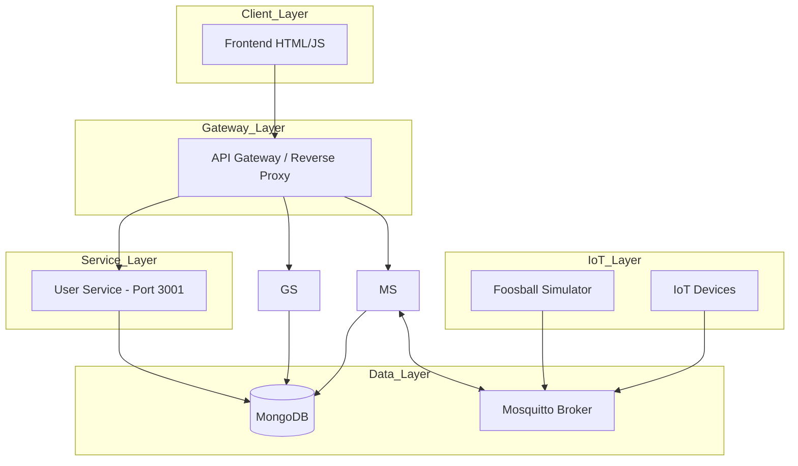

# Connected Games Platform (CGP) - Technical Architecture

## 1. Visione d'Insieme
La **Connected Games Platform (CGP)** è un'architettura a microservizi event-driven progettata per gestire giochi fisici (es. Calciobalilla, Freccette) connessi in rete. Il sistema permette il tracking in tempo reale dei punteggi tramite MQTT e la gestione di utenti e statistiche tramite API REST.

## 2. Diagramma di Architettura



## 3. Microservizi

| Servizio | Responsabilità | Database |
| :--- | :--- | :--- |
| **User Service** | Autenticazione (JWT), Profili, Classifiche, Gestione ruoli utente | `user_db` |
| **Game Service** | Registrazione tavoli fisici, stato hardware | `game_db` |
| **Match Service** | Gestione partite, punteggi live, logica di gioco | `match_db` |
| **Notification** | Bridge MQTT -> WebSockets per update UI | N/A |

## 4. Schema dei Dati (MongoDB)

### Ruoli Utente (User Service)

Il servizio utenti gestisce quattro ruoli standard:
- `PLAYER` — Giocatore normale.
- `LOCATION_ADMIN` — Amministratore del locale.
- `GAME_ADMIN` — Amministratore del gioco.
- `PLATFORM_ADMIN` — Amministratore della piattaforma.

### Match Collection (Match Service)
```json
{
  "gameId": "ObjectId",
  "status": "String (PENDING, ONGOING, FINISHED)",
  "players": [{"userId": "ObjectId", "team": "A|B"}],
  "score": {"teamA": "Number", "teamB": "Number"},
  "events": [{"type": "String", "payload": "Object", "timestamp": "Date"}],
  "startTime": "Date",
  "endTime": "Date"
}
```

## 5. Comunicazione MQTT

### Gerarchia Topic
- `games/{gameId}/events`: Messaggi in entrata dai dispositivi (es. `{ "event": "GOAL", "team": "A" }`).
- `games/{gameId}/commands`: Comandi inviati ai dispositivi (es. `{ "command": "RESET" }`).
- `matches/{matchId}/live`: Update in tempo reale per il frontend.

## 6. Endpoints API REST (Principali)

### Match Service
- `GET /matches`: Lista storica partite.
- `POST /matches/start`: Inizia una nuova sessione.
- `POST /matches/end`: Termina la partita corrente.
- `POST /matches/event`: Inserimento manuale di un evento.

### Game Service
- `GET /games`: Lista dei dispositivi registrati.
- `POST /games`: Registrazione nuovo hardware.

## 7. Struttura del Progetto

```text
GameBar/
├── docs/                  # Documentazione tecnica
├── backend/                # Microservizi Node.js
│   ├── user-service/
│   ├── game-service/
│   ├── match-service/
│   ├── tournament-service/
│   └── statistics-service/
├── simulator/             # Script di test MQTT
├── frontend/              # Dashboard Web
└── infrastructure/        # Configurazioni Docker e Broker
```

---
